# BITSOLVE REMIX — COMPLETE ARCHITECTURAL & CODE AUDIT REPORT

**Date:** November 21, 2026  
**Auditor:** Antigravity AI Assistant (Google DeepMind)  
**Target Product:** BITSolve REMIX  
**Primary Project (Source of Truth):** `bits-itsm/` (`C:\Users\ASUS\oops\bits-itsm`)  
**Secondary Project (Claude Alternative):** `oops-main/bits-itsm/` (`C:\Users\ASUS\oops-main-final\oops-main\bits-itsm`)  
**Status:** Analysis Complete — Awaiting User Approval  

---

## 1. Executive Summary

A comprehensive architectural and source-code-level inspection was performed on both **Project 1 (Our Original BITSolve)** and **Project 2 (Claude's Alternative Project)**. 

Both codebases share a common heritage in the CS F213 Object-Oriented Programming curriculum at BITS Pilani Hyderabad (Java 17/25, Spring Boot, PostgreSQL, React 19, Flyway, Vite). However, their evolutionary paths diverged sharply:

1. **Our Original Project (Source of Truth)** advanced heavily on **real-world campus business logic and domain automation**:
   - An intelligent automated incident classification engine (`IncidentClassificationService`) that parses student problem reports, detects services via catalog keywords, infers impact and urgency, and routes incidents without forcing students to pick complex IT metadata.
   - Pre-seeded campus problem templates (`problem_templates` in Flyway V8) covering campus-specific services (SWD Pay, SLMS/LMS, ERP, F Block Wi-Fi, Hostel LAN, BITS institutional email).
   - Strict privacy sanitization in the Knowledge Base (`ResolutionRecommendationService`), automatically redacting student IDs, emails, passwords/tokens, and phone numbers before solutions are surfaced.
   - A flexible technician transfer workflow where destination technicians are optional, allowing technicians to request reassignment when overwhelmed without knowing who to route to.
   - Extensive administrative control screens for classification review, urgency/impact tuning, template management, and knowledge base lookups.
   - 10 sequentially applied Flyway migrations (`V1` through `V10`).

2. **Claude's Project** focused heavily on **formal design patterns, visual dashboard analytics, and automated background jobs**:
   - A textbook implementation of the **State Pattern** (`com.bits.itsm.incident.state.*`) governing lifecycle transitions and actor permissions, including a new `AWAITING_INFO` state with SLA clock pause capabilities.
   - Rich interactive **Analytics & Insights** powered by Recharts (`Insights.jsx`, `InsightsController`, `InsightsService`) with 30-day incident trends, service breakdown, stacked technician workload capacity, CSV export with formula injection protection, and print-to-PDF styles.
   - Modern visual enhancements including SVG sidebar navigation icons (`NavIcon.jsx`), a role-aware `Welcome` header banner, and home widgets (`TechnicianFocus`, `AdminHome`).
   - Three additional Strategy Pattern assignment implementations (`RoundRobinAssignment`, `PriorityBasedAssignment`, `SmartRecommendation`).
   - An **Adapter Pattern** implementation for simulated SMS notifications (`SmsGatewayAdapter`, `ThirdPartySmsApi`).
   - An **AutoCloseScheduler** background task that automatically closes idle verified/resolved tickets after 72 hours.
   - Idempotency-Key support in ticket creation to eliminate duplicate submissions on double-clicking.

3. **Critical Warning on Database & Workflow Regressions in Claude's Project**:
   - **Flyway Version Collision**: Claude's project defined `V7__awaiting_info_and_assignment_strategies.sql` and `V8__affected_users_and_service_sla.sql`. In Our project, `V7` through `V10` are already applied and govern automatic classification, problem templates, and transfer requests. Running Claude's migrations directly would corrupt the Flyway migration history and crash the backend on startup.
   - **Student Workflow Regression**: Claude removed automated classification from the reporting form, forcing students to manually pick category, affected service, impact, urgency, and affected users.
   - **Administrative Regression**: Claude omitted four critical administrative management tabs (`Classification Review`, `Urgency & Impact Rules`, `Manage IT Problem Templates`, and `Knowledge Base`) from `AdminManagement.jsx` and `AdminDashboard.jsx`.
   - **Privacy Regression**: Claude's TF-IDF resolution suggester does not sanitize PII, potentially exposing student credentials, phone numbers, and private details to other technicians.

**Strategic Verdict**:
Our existing project remains the permanent foundation and single source of truth. The unified **BITSolve REMIX** will incorporate Claude's best UI widgets, Recharts analytics, State Pattern lifecycle (`AWAITING_INFO`), additional assignment strategies, SMS adapter, and background schedulers—while strictly preserving Our automated classification, campus templates, privacy sanitization, and Flyway migration chain.

---

## 2. Architecture Comparison

```mermaid
flowchart TD
    subgraph Client["Frontend Architecture (React 19 + Vite)"]
        UI_Shared["Shared Components & NavIcon"]
        UI_Student["Student Portal (Automated Reporting + Add Info)"]
        UI_Tech["Technician Portal (Focus SLA Risk + Assist)"]
        UI_Admin["Admin Portal (Full Controls + Recharts Insights)"]
    end

    subgraph API["Spring Boot REST API"]
        C_Auth["AuthController & RegistrationController"]
        C_Incident["IncidentController (Idempotent + Search)"]
        C_Assign["AssignmentController & AdminController"]
        C_Insights["InsightsController (Real Analytics & CSV)"]
        C_Classify["Classification & Template Controllers"]
    end

    subgraph Domain["Domain Layer (Design Patterns)"]
        DP_State["State Pattern (IncidentLifecycle + AwaitingInfo)"]
        DP_Strategy["Strategy Pattern (4 Priority + 5 Assignment)"]
        DP_Classify["Auto-Classification Engine & PII Redactor"]
        DP_Adapter["Adapter Pattern (SMS Gateway Adapter)"]
        DP_Observer["Observer Pattern (EventBus + Outboxes)"]
    end

    subgraph Persistence["PostgreSQL 16 Database"]
        FW["Flyway Migrations (V1..V10 + V11..V12 Safe Additions)"]
        TB_Incidents["incidents (with SLA pause & affected_users)"]
        TB_Classify["classification_settings & catalog_entries"]
        TB_Templates["problem_templates & transfer_requests"]
        TB_Audit["audit_records & notification_outbox"]
    end

    Client --> API
    API --> Domain
    Domain --> Persistence
```



### Architectural Dimension Breakdown

| Dimension | Project 1 (Our Original) | Project 2 (Claude) | REMIX Architectural Target |
|---|---|---|---|
| **Language & Runtime** | Java 17 / 25, Spring Boot 3.x, React 19 | Java 25, Spring Boot 4.1-ready, React 19 | Java 17/25 on Spring Boot 3.x / React 19 |
| **Lifecycle Architecture** | Procedural transitions with validation helper (`IncidentStates.java`) | Formal **State Pattern** (`IncidentLifecycle`, `IncidentState`, flyweight) | Adopt Claude's formal State Pattern; register all states including `AWAITING_INFO` |
| **Incident Classification** | Backend keyword analysis, ambiguity detection, automated priority calculation | Manual dropdowns selected by student | **Retain Our Original**: Zero cognitive burden on students |
| **Priority Determination** | 4 Strategy models (Multiplicative, Weighted, Matrix, Rule-Based) | Same 4 models + `AffectedUsersRule` decorator | Combine: 4 Strategy models with `AffectedUsersRule` post-processing |
| **Assignment Engine** | Strategy pattern (Skill-based, Load-based) | Strategy pattern (Skill, Load, Round-Robin, Priority-Based, Smart) | Combine: Expand registry to all 5 assignment strategies |
| **Notification System** | DB outbox + Real Gmail SMTP delivery worker with retries | In-app DB notifications + Simulated SMS Adapter pattern | Combine: Keep Real Gmail SMTP worker + Add SMS Adapter simulation |
| **Analytics & Reporting** | Tabular basic reports | Recharts charts, SLA MTTA/MTTR, Major incident clustering, CSV export | Adopt Claude's `InsightsService` and Recharts UI |
| **Knowledge Base** | PII-sanitized keyword matching (`ResolutionRecommendationService`) | TF-IDF vectorization with Cosine Similarity (`TfIdfSimilarityModel`) | Combine: Use Claude's TF-IDF model inside Our PII sanitization pipeline |
| **Idempotency** | Standard form submission | Client UUID + Server `ConcurrentHashMap` (10-min TTL) | Adopt Claude's Idempotency Key architecture |
| **Background Scheduling** | Manual / event-driven | `AutoCloseScheduler` (72-hour idle closure) | Adopt Claude's `AutoCloseScheduler` |

---

## 3. Feature-by-Feature Comparison (Tasks 1 & 2)

Every feature is classified using the mandatory rating criteria:
- **A**: Our existing implementation is better.
- **B**: Claude's implementation is better.
- **C**: Both should be combined.
- **D**: Claude has a feature we do not have.
- **E**: Neither implementation is complete.
- **F**: Demo-only and should not be imported.

---

### Feature 1: Student Portal
- **Classification:** **C (Both should be combined)**
- **Our Implementation:** Simple, student-friendly incident reporting (title + description or problem template); automated backend classification; ticket progress tracker; resolution verification and feedback rating; student profile with sign-out.
- **Claude's Implementation:** Introduces role-aware `Welcome` banner with real-time greeting; SVG `NavIcon` sidebar; visual notice when ticket is `AWAITING_INFO` (indicating the technician needs information and the SLA clock is paused); and an "Add information" form to append supplemental info to open tickets. However, Claude regressed the report form by forcing students to choose category, service, impact, urgency, and affected users.
- **Why Combine:** Keep Our simplified automated reporting and campus templates; adopt Claude's `Welcome` header, `NavIcon` navigation, `AWAITING_INFO` paused clock status banner, and the student's ability to append info.

---

### Feature 2: Technician Portal
- **Classification:** **C (Both should be combined)**
- **Our Implementation:** Full operational dashboard: assigned tickets, workload gauges, transfer requests with optional destination technician, collaboration requests, investigation notes, resolution submission, and PII-sanitized knowledge base search.
- **Claude's Implementation:** Introduces `TechnicianFocus` home widget ("Work on these first — Predicted SLA risk"); `IncidentAssist` recommendations and suggested solutions; full support for the `AWAITING_INFO` state; but forces technicians to name a receiving technician on transfer requests.
- **Why Combine:** Retain Our flexible transfer request model (technicians can request transfer without knowing who takes it) and sanitized solutions; import Claude's `TechnicianFocus` SLA risk widget, `IncidentAssist`, and `AWAITING_INFO` transitions.

---

### Feature 3: Administrator Portal
- **Classification:** **A (Our existing implementation is better)**
- **Our Implementation:** Deep administrative governance across 10 dedicated sections, including:
  1. `Manage IT Problem Templates`
  2. `Classification Review` (reviewing auto-classified tickets, overriding service/severity with mandatory audit reason)
  3. `Urgency & Impact Rules` (live tuning of campus keyword sets and default thresholds)
  4. `Knowledge Base` (central search for sanitized resolutions)
  5. `Manage Users` (with account enabling/disabling)
  6. `IT Services` & `Incident Categories`
  7. `Assignment Strategies` & `SLA Policies`
  8. `Escalations` & `Audit Logs`
- **Claude's Implementation:** Stripped out Classification Review, Problem Templates, Urgency & Impact Rules, and Knowledge Base. However, Claude added an excellent `AdminHome` KPI widget bar and `Insights & Analytics` tab.
- **Why:** Our administration capabilities are far more complete and essential for campus operation. We will adopt Claude's `AdminHome` and `Insights` tab into Our existing administrative navigation.

---

### Feature 4: Dashboard and Analytics
- **Classification:** **B (Claude's implementation is better)**
- **Our Implementation:** Static counters and basic list views. No visual charts or automated trend analysis.
- **Claude's Implementation:** High-grade analytics suite in `Insights.jsx` backed by `InsightsService.java`:
  - 30-day incident trend (Reported vs. Resolved) line chart via Recharts.
  - Incident volume by IT service horizontal bar chart.
  - Technician workload stacked bar chart (Active load vs. Remaining capacity).
  - Category distribution bar chart.
  - Live calculation of MTTA (Mean Time to Acknowledge), MTTR (Mean Time to Resolve), and SLA compliance percentage.
  - Formula-injection-safe CSV export (`bitsolve-incidents.csv`) and print-optimized PDF view.
- **Why:** Claude's analytics engine is fully connected to live JPA entities and provides immediate institutional visibility.

---

### Feature 5: Incident Reporting
- **Classification:** **C (Both should be combined)**
- **Our Implementation:** Students simply describe their issue or pick from 20 BITS campus problem templates (SWD Pay, SLMS, LMS, F Block Wi-Fi, etc.). Background classification infers category, service, impact, and urgency.
- **Claude's Implementation:** Students must manually pick 5 technical fields. However, Claude implements an **Idempotency Key** mechanism: the client generates a unique UUID on form load (`submissionKey`), sends it via the `Idempotency-Key` HTTP header, and the server deduplicates rapid clicks within a 10-minute window via `ConcurrentHashMap`.
- **Why Combine:** Keep Our automated problem templates and simplified form; incorporate Claude's Idempotency Key header and backend validation.

---

### Feature 6: Incident Classification
- **Classification:** **A (Our existing implementation is better)**
- **Our Implementation:** Production-grade `IncidentClassificationService`:
  - Normalized keyword extraction matching against `catalog_entries.keywords`.
  - Ambiguity detection (flags tickets if keywords tie across multiple services).
  - Rule-based evaluation of urgency and impact keywords.
  - Uncertainty flag (`needs_classification_review`) routing uncertain tickets to admin review.
  - Automatic calculation of initial priority and SLA target capture.
  - Reclassification audit trail with mandatory administrative reason.
- **Claude's Implementation:** Completely missing. Relies entirely on manual student entry.
- **Why:** Our classification system is one of the most sophisticated custom features in the codebase.

---

### Feature 7: Priority Calculation
- **Classification:** **C (Both should be combined)**
- **Our Implementation:** 4 runtime-switchable strategies (Multiplicative, Weighted, Matrix, Rule-Based) configurable from the Admin UI, persisted in PostgreSQL JSONB, with live preview endpoints.
- **Claude's Implementation:** Same 4 strategies, plus `AffectedUsersRule.java` (a decorator that raises the priority by 1 level if `affectedUsers > 100`).
- **Why Combine:** Keep Our 4 runtime strategies and administrative UI; integrate `AffectedUsersRule` as an additional factor evaluated during automatic classification.

---

### Feature 8: Technician Assignment
- **Classification:** **C (Both should be combined)**
- **Our Implementation:** Strategy pattern supporting `SkillBasedAssignment` and `LoadBasedAssignment`, factoring in primary vs. secondary (collaborator) workloads.
- **Claude's Implementation:** Adds 3 new strategies:
  1. `RoundRobinAssignment`: Thread-safe cyclic rotation per skill using `ConcurrentHashMap<String, AtomicInteger>`.
  2. `PriorityBasedAssignment`: Routes P1/P2 incidents to senior technicians (resolved count >= threshold), delegating P3/P4 to load-based assignment.
  3. `SmartRecommendation`: Multi-factor ranking:
     $$\text{Score} = 0.35 \cdot \text{Skill} + 0.25 \cdot (1 - \text{Load Ratio}) + 0.20 \cdot \text{Experience} + 0.20 \cdot \text{Service History}$$
     Generates human-readable rationale strings for admin transparency.
- **Why Combine:** Register Claude's 3 new strategies into Our assignment strategy repository and UI, while retaining Our transactional assignment and event notification pipeline.

---

### Feature 9: Technician Availability
- **Classification:** **A (Our existing implementation is better)**
- **Our Implementation:** Fully integrated into database (`AVAILABLE`, `BUSY`, `UNAVAILABLE`), managed in Admin UI, checked dynamically in `WorkloadService` candidate filtering, and tested against real database queries.
- **Claude's Implementation:** Checks availability flag and throws `TechnicianUnavailableException`.
- **Why:** Our availability tracking is already deeply wired into the persistence layer and candidate generation. Claude's custom exception class should be adopted to clean up HTTP error responses.

---

### Feature 10: Incident Transfers
- **Classification:** **A (Our existing implementation is better)**
- **Our Implementation:** Flyway migration `V9__technician_transfer_requests.sql` made `proposed_technician_id` nullable, enabling technicians to submit a transfer request when overwhelmed even if they do not know who is available. The administrator can approve and select any destination technician. Audits record full handover notes, reasons, and review notes into incident history.
- **Claude's Implementation:** Forces a destination technician (`technicianId` required), removing the ability to request an unassigned transfer.
- **Why:** Our workflow matches real campus IT helpdesk operations.

---

### Feature 11: Technician Collaboration
- **Classification:** **C (Both should be combined)**
- **Our Implementation:** Primary technicians can request collaborators by required skill; admins approve; collaborators are attached to the incident; collaborators can post internal notes; workload calculations weight secondary participation as 1 (vs. 2 for primary).
- **Claude's Implementation:** Mirrors Our structure, but ties collaboration activity into the formal State pattern (`countsTowardWorkload` returns true for active states).
- **Why Combine:** Keep Our collaboration tables and UI while adopting Claude's lifecycle method bindings.

---

### Feature 12: SLA Policies and Escalation
- **Classification:** **C (Both should be combined)**
- **Our Implementation:** SLA policies per priority; capture of response and resolution deadlines; background monitoring; escalation records and escalation history.
- **Claude's Implementation:** 
  1. Implements `AWAITING_INFO` state with paused SLA clock (`sla_paused_at`, `sla_paused_seconds`). Time waiting for the student is not charged against the IT team.
  2. `AutoCloseScheduler`: Background task automatically closing verified/resolved tickets after 72 hours of student inactivity.
  3. Per-service `sla_factor` (0.25 to 4.0) to lengthen or shorten SLA deadlines for complex services.
  4. `SlaRiskPredictor`: Formula-based SLA risk scoring ($0.5 \cdot \text{elapsed} + 0.25 \cdot \text{workload} + 0.25 \cdot \text{history}$).
- **Why Combine:** Integrate Claude's SLA pause, auto-close scheduler, and risk predictor into Our existing SLA engine.

---

### Feature 13: Knowledge Base
- **Classification:** **C (Both should be combined)**
- **Our Implementation:** `ResolutionRecommendationService.java` features strict PII sanitization (redacting email addresses, passwords, API tokens, phone numbers, and student IDs via regex and student profile lookups) before storing or surfacing suggestions. Has `AdminKnowledgeBase.jsx` and `SuggestedSolutions.jsx`.
- **Claude's Implementation:** `ResolutionSuggester.java` implements a mathematical TF-IDF vectorization and cosine similarity model (`TfIdfSimilarityModel.java`), ranking past resolutions by text relevance. However, it lacks PII sanitization.
- **Why Combine:** Retain Our PII sanitization engine and admin UI, while plugging Claude's `TfIdfSimilarityModel` in as an advanced `ResolutionMatchingStrategy`.

---

### Feature 14: Notifications and Gmail
- **Classification:** **C (Both should be combined)**
- **Our Implementation:** Production Gmail SMTP worker (`EmailChannel.java`) with STARTTLS, port 587, connection/read timeouts, exponential backoff retries, transactional outbox table, and strict error sanitization.
- **Claude's Implementation:** In-app notification observer; plus an **Adapter Pattern** implementation for simulated SMS notifications (`SmsGatewayAdapter` adapting `ThirdPartySmsApi`), with an SMS outbox view in the analytics dashboard.
- **Why Combine:** Keep Our real Gmail SMTP production engine, and add Claude's SMS Adapter pattern as a demonstration of the Adapter pattern and secondary alert channel.

---

### Feature 15: Authentication and Authorization
- **Classification:** **C (Both should be combined)**
- **Our Implementation:** Spring Security session-based auth; CSRF protection (`/api/auth/csrf`); BCrypt password hashing; login role mismatch detection; enabled account check; self-registration in `AuthController`.
- **Claude's Implementation:** Dedicated `RegistrationController` with a configuration toggle (`bitsolve.registration.enabled`), explicit Bean Validation, `UserFactory` instantiation, and unified `ApiError` responses to prevent user enumeration attacks.
- **Why Combine:** Adopt `UserFactory` and `RegistrationController` with feature toggle while preserving Our security configuration and personalized `//*` comments.

---

### Feature 16: PostgreSQL Schema
- **Classification:** **A (Our existing implementation is better & MUST be preserved)**
- **Our Implementation:** 10 migrations (`V1` through `V10`) applied. Defines `classification_settings`, `problem_templates`, `catalog_entries.keywords`, nullable incident fields for classification, and performance indexes.
- **Claude's Implementation:** Incomplete schema missing classification settings, problem templates, and transfer updates. Conflicting V7 and V8 files.
- **Why:** Our schema is the live source of truth. Under no circumstances should Claude's schema replace Ours.

---

### Feature 17: Flyway Migrations
- **Classification:** **A (Our existing implementation is better & MUST be preserved)**
- **Our Implementation:** Complete, sequential, clean history from V1 to V10.
- **Claude's Implementation:** Collides at V7 and V8.
- **Why:** Claude's new columns (`sla_paused_at`, `sla_paused_seconds`, `affected_users`, `sla_factor`) must be packaged into new, non-destructive migrations `V11` and `V12`.

---

### Feature 18: Testing and Documentation
- **Classification:** **C (Both should be combined)**
- **Our Implementation:** Integration test suite covering classification, problem templates, technician availability, assignment, and authentication.
- **Claude's Implementation:** JaCoCo coverage profile in `pom.xml`, PlantUML architecture and sequence diagrams, formal decision logs (`DECISIONS.md`), testing guides (`TEST_CASES.md`, `P4-TESTING.md`), and automated tests for State transitions and SMS adapters.
- **Why Combine:** Incorporate Claude's documentation, PlantUML diagrams, and JaCoCo maven profile while retaining Our test suite.

---

## 4. Frontend Comparison (Task 4)

### Component Matrix

| Component | Our Original (`bits-itsm/frontend`) | Claude (`oops-main/bits-itsm/frontend`) | REMIX Recommendation |
|---|---|---|---|
| `components/NavIcon.jsx` | Does not exist | 24px SVG stroke icons mapped to navigation labels | **Adopt Claude's component**: elevates visual quality across all 3 portals |
| `HomePanels.jsx` | Does not exist | `Welcome`, `TechnicianFocus`, and `AdminHome` widgets | **Adopt Claude's component**: provides role-specific dashboards |
| `Insights.jsx` | Does not exist | Complete Recharts dashboard with line/bar charts, CSV export, PDF print | **Adopt Claude's component**: integrated into Admin portal |
| `IncidentAssist.jsx` | Embedded in `SuggestedSolutions.jsx` | Recommendations (with score reasoning) + SuggestedResolutions | **Adopt Claude's component**: enhanced AI assistance |
| `Register.jsx` | Embedded in `App.jsx` | Standalone floating-label form with validation | **Adopt Claude's component**: cleaner separation of concerns |
| `ReportIncident.jsx` | Simplified (Title + Description + Problem Templates) | Manual (Category, Service, Impact, Urgency, AffectedUsers) + Idempotency Key | **Combine**: Keep Our simplified form + templates; add Claude's Idempotency Key |
| `AdminManagement.jsx` | 10 sections (incl. Classification Review, Rules, Templates, KB) | 7 sections (basic catalog/users only) | **Retain Our Original**: far superior administrative capability |
| `pages/AdminDashboard.jsx` | Full navigation with classification & KB | Omitted classification; added Insights & AdminHome | **Combine**: Add Claude's `AdminHome` & `Insights` to Our full admin menu |
| `pages/StudentDashboard.jsx` | Progress tracker, problem templates, profile | Added `Welcome`, `NavIcon`, and `AWAITING_INFO` state | **Combine**: Add Claude's `Welcome`, `NavIcon`, and `AWAITING_INFO` notices |
| `pages/TechnicianDashboard.jsx` | Standard workload & transfer requests | Added `TechnicianFocus` SLA risk widget and `NavIcon` | **Combine**: Add Claude's `TechnicianFocus` and `NavIcon` |
| `StudentIncidentActions.jsx` | Verification & feedback forms | Added `AWAITING_INFO` reply form and proactive "Add Information" form | **Adopt Claude's additions**: empowers students to update tickets |
| `TechnicianOperations.jsx` | Optional proposed technician on transfers | Mandatory proposed technician on transfers | **Retain Our Original**: destination technician must remain optional |

### Critical Business Workflow Rule
> [!IMPORTANT]
> Students must NEVER regain manual control over `category`, `affectedService`, `impact`, or `urgency`. Our backend automated classification engine determines these attributes dynamically from the report text. The REMIX frontend will strictly retain Our streamlined student reporting interface while adopting Claude's visual polish and idempotency protection.

---

## 5. Backend Comparison (Task 5)

### Java Architectural Patterns

1. **State Pattern (`com.bits.itsm.incident.state.*`)**:
   - Claude created a clean Flyweight registry (`IncidentLifecycle`) holding stateless singletons for each `IncidentStatus`.
   - Each state class (`NewState`, `ClassifiedState`, `AssignedState`, `AcknowledgedState`, `InProgressState`, `AwaitingInfoState`, `ResolvedState`, `VerifiedState`, `ClosedState`) enforces valid outgoing transitions and allowed actors (`STUDENT`, `TECHNICIAN`, `ADMIN`, `SYSTEM`).
   - `Incident.java` delegates transition validation to the state object: `IncidentLifecycle.of(status).requireTransition(target, actor)`.
   - *Verdict:* Safe to integrate into Our project without breaking entity mappings.

2. **Assignment Strategy Pattern (`com.bits.itsm.assignment.*`)**:
   - Our project has `SkillBasedAssignment` and `LoadBasedAssignment`.
   - Claude added `RoundRobinAssignment`, `PriorityBasedAssignment`, and `SmartRecommendation`.
   - All three adhere cleanly to Our `AssignmentStrategy` interface.
   - *Verdict:* Excellent candidate for immediate inclusion.

3. **Exception Handling (`com.bits.itsm.exception.*`)**:
   - Our project relied on Spring's `ResponseStatusException` and localized controller handlers.
   - Claude created a centralized `BitsolveException` hierarchy with `GlobalApiErrors` delivering standardized JSON error payloads:
     ```json
     {
       "timestamp": "2026-11-21T16:20:00Z",
       "status": 409,
       "code": "DUPLICATE_INCIDENT",
       "message": "A report with this submission key was already received.",
       "path": "/api/incidents"
     }
     ```
   - *Verdict:* Major architectural upgrade.

4. **Preservation of Personalized Comments**:
   - Our source code contains personalized comments such as:
     `//*regex used here to identify to allow bits official id to have access to it portal`
   - These comments are strictly preserved in the REMIX codebase.

---

## 6. Database Migration Conflict Report (Task 3)

This is the most critical technical finding of the entire audit.

### Migration Inventory

| Migration Version | Project 1 (Our Original) | Project 2 (Claude) | Conflict Status |
|---|---|---|---|
| `V1` | `V1__persistent_campus_support.sql` (12,987 B) | `V1__persistent_campus_support.sql` (12,986 B) | **Identical** (1-byte line-ending difference) |
| `V2` | `V2__integrity_and_lookup_indexes.sql` | `V2__integrity_and_lookup_indexes.sql` | **Identical** |
| `V3` | `V3__capture_legacy_sla_targets.sql` | `V3__capture_legacy_sla_targets.sql` | **Identical** |
| `V4` | `V4__student_email_delivery.sql` | `V4__student_email_delivery.sql` | **Identical** |
| `V5` | `V5__four_priority_strategies.sql` | `V5__four_priority_strategies.sql` | **Identical** |
| `V6` | `V6__explicit_service_criticality.sql` | `V6__explicit_service_criticality.sql` | **Identical** |
| `V7` | `V7__automatic_classification.sql` (5,482 B) | `V7__awaiting_info_and_assignment_strategies.sql` (1,085 B) | **CRITICAL COLLISION** |
| `V8` | `V8__campus_problem_templates.sql` (2,826 B) | `V8__affected_users_and_service_sla.sql` (660 B) | **CRITICAL COLLISION** |
| `V9` | `V9__technician_transfer_requests.sql` (1,102 B) | *Does not exist* | **Missing in Claude** |
| `V10` | `V10__resolution_recommendation_candidates.sql` (201 B) | *Does not exist* | **Missing in Claude** |

### Conflict Details & Hazards
1. **Flyway Checksum Mismatch:** In PostgreSQL, the `flyway_schema_history` table records the checksum of each executed migration. If Claude's `V7` or `V8` were dropped into Our folder, Spring Boot would fail to start with `FlywayValidateException: Validate failed: Migration checksum mismatch for migration version 7`.
2. **Schema Incompatibility:**
   - In Our project, `V7` makes `category`, `affected_service`, `impact`, and `urgency` nullable on the `incidents` table and creates `classification_settings`.
   - Claude's `V7` alters `incidents_status_check` to include `AWAITING_INFO`, adds `sla_paused_at` and `sla_paused_seconds`, and adds strategies to `assignment_settings`.
   - Claude's `V8` adds `affected_users` to `incidents` and `sla_factor` to `catalog_entries`.
   - If Claude's `V7` ran in place of Ours, `classification_settings` and `problem_templates` would not exist, breaking the entire classification engine!

### Safe Resolution Plan
Claude's database enhancements will be ported forward as **additive, non-destructive migrations**:
- **`V11__awaiting_info_and_assignment_strategies.sql`**:
  ```sql
  -- Safe additive migration adapting Claude's V7
  alter table incidents drop constraint if exists incidents_status_check;
  alter table incidents add constraint incidents_status_check
      check (status in ('NEW','CLASSIFIED','ASSIGNED','ACKNOWLEDGED','IN_PROGRESS','AWAITING_INFO','RESOLVED','VERIFIED','CLOSED'));

  alter table incidents add column if not exists sla_paused_at timestamp(6) with time zone;
  alter table incidents add column if not exists sla_paused_seconds bigint not null default 0;

  alter table assignment_settings drop constraint if exists assignment_settings_strategy_check;
  alter table assignment_settings add constraint assignment_settings_strategy_check
      check (strategy in ('SKILL_BASED','LOAD_BASED','ROUND_ROBIN','PRIORITY_BASED','SMART'));

  create index if not exists incident_status_updated_idx on incidents (status, updated_at);
  ```
- **`V12__affected_users_and_service_sla.sql`**:
  ```sql
  -- Safe additive migration adapting Claude's V8
  alter table incidents add column if not exists affected_users integer check (affected_users is null or affected_users between 1 and 100000);
  alter table catalog_entries add column if not exists sla_factor double precision not null default 1.0 check (sla_factor between 0.25 and 4.0);
  alter table incidents add column if not exists sla_factor double precision;
  ```

---

## 7. Security Comparison

| Security Dimension | Project 1 (Our Original) | Project 2 (Claude) | REMIX Standard |
|---|---|---|---|
| **Authentication** | Spring Security session cookies, BCrypt hashing (strength 10), role mismatch verification | Spring Security session cookies, BCrypt hashing (strength 10), generic error responses | Combine: Session cookies + generic `InvalidLoginException` (prevents account enumeration) |
| **CSRF Defense** | Strict CSRF token rotation on all mutations (`/api/auth/csrf`) | Same strict CSRF token rotation | Retain active CSRF protection |
| **Session Fixation** | `SessionAuthenticationStrategy` rotates session IDs on login | Same session rotation | Retain session rotation |
| **Account Enumeration** | Reports "Invalid email or password" or "wrong login role" | Unified `ApiError` payload; always returns HTTP 401 | Adopt Claude's unified `ApiError` |
| **Formula Injection** | None on standard CSV | Sanitizes all CSV cells (`=+-@\t\r` prefix guard) | **Adopt Claude's formula injection guard** |
| **Data Privacy (PII)** | **Strict PII Redaction** (regex + user lookup cleans emails, passwords, phones, IDs) | None (raw titles/descriptions exposed to TF-IDF) | **Enforce Our Strict PII Redaction** |
| **Email Security** | SMTP credentials via ENV vars; STARTTLS enforced; error messages sanitized | N/A (simulated only) | Retain Our production email security |
| **Idempotency Defense** | Standard database constraints | Server-side atomic `putIfAbsent` prevents double-submission replay | **Adopt Claude's Idempotency Key check** |

---

## 8. Mock Data versus Real Data Findings

1. **Frontend Previews vs. Live Sessions:**
   - Both codebases use `demoData.js` strictly when running in unauthenticated development preview mode (`?preview=student`, `?preview=technician`, `?preview=admin`).
   - When a user logs in with an institutional account, **100% of data flows from PostgreSQL** via `/api/*` endpoints.

2. **Claude's `DemoIncidentSeeder.java`:**
   - Claude includes a seeder that inserts 60 synthetic incidents across a 30-day timeline into PostgreSQL.
   - **Safety Check:** The seeder is annotated with `@Profile("dev & !prod & !production")` and `@ConditionalOnProperty(name = "bitsolve.demo.seed-enabled", havingValue = "true")`. It checks `count(*) from incidents` and aborts if any incident already exists.
   - **Audit Decision:** This seeder will NOT be run on Our database to protect historical campus records.

3. **Analytics Engine Reality:**
   - Claude's `InsightsService.java` does **NOT** use mock data. It executes real JPA queries (`incidents.findAll()`, `workloads.all()`, `findTeamIncidents`) and computes mathematical aggregations in Java.

4. **Simulated SMS vs. Real Gmail:**
   - Our Gmail worker (`EmailChannel.java`) connects to real SMTP (`smtp.gmail.com:587`).
   - Claude's SMS channel (`SmsGatewayAdapter.java`) is explicitly simulated—it writes formatted log entries and stores messages in memory for the `admin/sms-outbox` dashboard table.

---

## 9. Exact Source-to-Destination Mapping (Task 6)

| # | Claude Source File | Our Destination File | Action | Dependencies | Risk | Verification Tests |
|---|---|---|---|---|---|---|
| 1 | `frontend/src/components/NavIcon.jsx` | `frontend/src/components/NavIcon.jsx` | **Reuse** | None | Low | Component visual render test in Storybook/Vite |
| 2 | `frontend/src/HomePanels.jsx` | `frontend/src/HomePanels.jsx` | **Adapt** | Backend `InsightsService` endpoints | Medium | Verify `Welcome`, `TechnicianFocus`, and `AdminHome` render properly |
| 3 | `frontend/src/Insights.jsx` | `frontend/src/Insights.jsx` | **Adapt** | `recharts: ^3.2.1` in `package.json`, backend `InsightsController` | Medium | Verify 4 charts, KPI cards, CSV export, print dialog |
| 4 | `frontend/src/IncidentAssist.jsx` | `frontend/src/IncidentAssist.jsx` | **Adapt** | Backend recommendation endpoints | Low | Verify technician scoring cards and reasons render |
| 5 | `frontend/src/Register.jsx` | `frontend/src/Register.jsx` | **Adapt** | `RegistrationController` on backend | Low | Test registration with valid and invalid BITS emails |
| 6 | `frontend/package.json` (dependencies) | `frontend/package.json` | **Adapt** | Add `"recharts": "^3.2.1"` | Low | `npm install` (post-audit approval) |
| 7 | `backend/src/main/resources/db/migration/V7__awaiting_info_and_assignment_strategies.sql` | `backend/src/main/resources/db/migration/V11__awaiting_info_and_assignment_strategies.sql` | **Adapt** | Rename to V11; verify constraint syntax | Low | Test Flyway migration on clean test schema |
| 8 | `backend/src/main/resources/db/migration/V8__affected_users_and_service_sla.sql` | `backend/src/main/resources/db/migration/V12__affected_users_and_service_sla.sql` | **Adapt** | Rename to V12 | Low | Test Flyway migration on clean test schema |
| 9 | `backend/.../incident/state/*` (13 files) | `backend/.../incident/state/*` | **Reuse** | `InvalidStateTransitionException` | Medium | `IncidentStateMachineTest` unit tests |
| 10 | `backend/.../exception/*` (14 files) | `backend/.../exception/*` | **Reuse** | None | Low | `ExceptionHandlingTest` unit tests |
| 11 | `backend/.../assignment/RoundRobinAssignment.java` | `backend/.../assignment/RoundRobinAssignment.java` | **Reuse** | `AssignmentStrategy` interface | Low | Concurrency test with parallel threads |
| 12 | `backend/.../assignment/PriorityBasedAssignment.java` | `backend/.../assignment/PriorityBasedAssignment.java` | **Reuse** | `Candidate.resolvedCount()` | Low | Priority routing test for P1 vs P4 |
| 13 | `backend/.../assignment/SmartRecommendation.java` | `backend/.../assignment/SmartRecommendation.java` | **Reuse** | `Candidate` service history fields | Low | Weighted score ranking unit test |
| 14 | `backend/.../assignment/AssignmentStrategies.java` | `backend/.../assignment/AssignmentStrategies.java` | **Adapt** | Wire into `AssignmentService` | Medium | Integration test strategy selection |
| 15 | `backend/.../priority/AffectedUsersRule.java` | `backend/.../priority/AffectedUsersRule.java` | **Reuse** | None | Low | Unit test threshold > 100 users |
| 16 | `backend/.../sla/AutoCloseScheduler.java` | `backend/.../sla/AutoCloseScheduler.java` | **Reuse** | `@EnableScheduling`, `IncidentService.autoClose` | Medium | Mock time test verifying 72h auto-closure |
| 17 | `backend/.../notification/sms/*` (4 files) | `backend/.../notification/sms/*` | **Reuse** | None | Low | `SmsAdapterTest` unit test |
| 18 | `backend/.../intelligence/TfIdfSimilarityModel.java` | `backend/.../intelligence/TfIdfSimilarityModel.java` | **Reuse** | `TextSimilarity` tokens | Low | Math precision cosine similarity tests |
| 19 | `backend/.../api/InsightsController.java` & `InsightsService.java` | `backend/.../api/InsightsController.java` & `InsightsService.java` | **Adapt** | Align with Our `IncidentRepository` | Medium | Full API integration tests |
| 20 | `backend/.../auth/RegistrationController.java` | `backend/.../auth/RegistrationController.java` | **Reuse** | `UserFactory`, `EmailValidator` | Low | Registration API tests |
| 21 | `backend/.../user/UserFactory.java` | `backend/.../user/UserFactory.java` | **Reuse** | Role and User classes | Low | Factory instantiation tests |
| 22 | `docs/uml/*` and `docs/*.md` | `docs/uml/*` and `docs/reference/*` | **Reuse** | None | Low | Documentation review |

---

## 10. Integration Risks & Mitigations

| Risk | Impact | Probability | Mitigation Strategy |
|---|---|---|---|
| **Flyway Checksum Mismatch** | High (Server crash on startup) | Zero (with plan) | Never overwrite V7/V8. Deploy Claude's migrations as V11 and V12. |
| **Loss of Automated Classification** | High (Student UX failure) | Zero (with plan) | Retain Our `ReportIncident.jsx` and `IncidentClassificationService.java` as immutable truth. |
| **Accidental PII Exposure** | High (Privacy violation) | Zero (with plan) | Do not use Claude's unredacted suggester; run Claude's TF-IDF model inside Our sanitization pipeline. |
| **Recharts Dependency Missing** | Medium (Frontend build fail) | Zero (with plan) | Add `recharts: ^3.2.1` to `package.json` before importing `Insights.jsx`. |
| **Transfer Request Inflexibility** | Medium (Workflow roadblock) | Zero (with plan) | Retain Our optional destination technician parameter in `TransferRequest`. |
| **State Pattern Regression** | Medium (Illegal transition bugs) | Low | Ensure `AwaitingInfoState` allows transition back to `IN_PROGRESS` when student comments. |
| **Git Merge Conflicts** | High (Code corruption) | Zero (with plan) | Follow Task 8: do not commit or branch during audit; create a clean isolated branch `feature/remix-integration` post-approval. |

---

## 11. Recommended Implementation Sequence (Task 7)

```mermaid
flowchart LR
    P1["Phase 1: Safe Flyway V11/V12 & State Pattern"] --> P2["Phase 2: Insights & Recharts Analytics"]
    P2 --> P3["Phase 3: Student Experience & Idempotency"]
    P3 --> P4["Phase 4: Technician Focus & Smart Assign"]
    P4 --> P5["Phase 5: TF-IDF Sanitized Knowledge Base"]
    P5 --> P6["Phase 6: Admin Dashboard Unification"]
    P6 --> P7["Phase 7: SMS Adapter & AutoClose Job"]
    P7 --> P8["Phase 8: Regression Testing & JaCoCo"]
```



### Phase 1: Safe Database Migrations & State Pattern Core
- Create Flyway migrations `V11__awaiting_info_and_assignment_strategies.sql` and `V12__affected_users_and_service_sla.sql`.
- Import the `com.bits.itsm.incident.state.*` package (State Pattern) and `com.bits.itsm.exception.*` hierarchy.
- Update `Incident.java` to support `slaPausedAt`, `slaPausedSeconds`, `affectedUsers`, `slaFactor`, and delegate transition validation to `IncidentLifecycle`.
- Verify database boots cleanly with zero Flyway checksum errors.

### Phase 2: Real Analytics & Recharts Dashboard
- Add `"recharts": "^3.2.1"` to `frontend/package.json`.
- Port `InsightsService.java` and `InsightsController.java` to backend.
- Port `frontend/src/Insights.jsx`.
- Verify CSV export with formula injection protection and 30-day trend chart.

### Phase 3: Student Portal Polish & Idempotency
- Port `NavIcon.jsx` and `HomePanels.jsx` (`Welcome` banner).
- Enhance `ReportIncident.jsx` with client Idempotency Key header, keeping Our simplified form and campus problem templates.
- Update `StudentIncidentActions.jsx` to render the `AWAITING_INFO` alert banner and allow students to append information.
- Import `Register.jsx` and backend `RegistrationController.java`.

### Phase 4: Technician Portal & Smart Assignment
- Add `TechnicianFocus.jsx` widget to technician home view.
- Import `RoundRobinAssignment`, `PriorityBasedAssignment`, and `SmartRecommendation` into backend.
- Wire `IncidentAssist.jsx` recommendation cards into `IncidentManagementActions.jsx`.
- Preserve optional proposed technician logic on transfer requests.

### Phase 5: TF-IDF Knowledge Base with PII Sanitization
- Import `TfIdfSimilarityModel.java`.
- Create `TfIdfResolutionMatchingStrategy.java` implementing Our `ResolutionMatchingStrategy` interface.
- Ensure all inputs and outputs pass through Our PII sanitization regex filters.

### Phase 6: Administrator Management Unification
- Update `AdminDashboard.jsx` to include `AdminHome` KPIs and `Insights & Analytics` tab.
- Retain all 10 existing admin tabs (`Classification Review`, `Urgency & Impact Rules`, `Manage IT Problem Templates`, etc.).
- Add `NavIcon` to all admin sidebar navigation items.

### Phase 7: Automations & Simulated SMS Adapter
- Import `SmsGatewayAdapter`, `ThirdPartySmsApi`, and `SmsChannel`.
- Import `AutoCloseScheduler` with `@Scheduled` pass for 72-hour idle tickets.
- Connect SMS events to SLA breach and P1 escalation triggers.

### Phase 8: Full Regression Testing & Verification
- Add JaCoCo coverage profile to `backend/pom.xml`.
- Run all existing tests (`PostgresIncidentTests`, `IncidentClassificationServiceTest`, `PostgresAssignmentTests`, etc.) plus Claude's test suite (`IncidentStateMachineTest`, `NewAssignmentStrategiesTest`, `CsvExportTest`).
- Perform end-to-end user testing across Student, Technician, and Admin roles.

---

## 12. Features We Should Reject (Negative Scope)

1. **REJECT: Overwriting Flyway V7 and V8:**
   - Claude's `V7` and `V8` must NEVER be copied over Our existing migrations. Doing so causes immediate Flyway checksum failure and breaks `classification_settings` and `problem_templates`.
2. **REJECT: Claude's Manual Incident Reporting Form:**
   - Do NOT force students to pick category, service, impact, urgency, and affected users. Students should only submit title, description, and optional problem template.
3. **REJECT: Removal of Administrative Governance Screens:**
   - Do NOT accept Claude's stripped-down `AdminManagement.jsx` or `AdminDashboard.jsx`. Classification Review, Urgency & Impact Rules, Problem Templates, and Knowledge Base must remain active.
4. **REJECT: Mandatory Proposed Technician on Transfers:**
   - Do NOT make destination technician mandatory. Technicians must be able to request an unassigned transfer when overwhelmed.
5. **REJECT: Unsanitized TF-IDF Knowledge Base:**
   - Do NOT use Claude's `ResolutionSuggester` directly without Our PII sanitization layer. Exposing student passwords, tokens, or roll numbers is a security violation.
6. **REJECT: Replacing Our Real Gmail SMTP with Mock SMS:**
   - Do NOT discard Our production Gmail SMTP delivery queue. The SMS adapter should be an addition, not a replacement.
7. **REJECT: Importing Claude's Sample Database:**
   - Do NOT load Claude's 60 hardcoded demo incidents into Our live database.

---

## 13. Git Safety Report (Task 8)

Inspection of the primary project Git repository (`C:\Users\ASUS\oops`):
- **Current Branch:** `main` (commit `ef70694`: *"Implement BITSolve campus support features"*)
- **Working Tree State:**
  - `modified: bits-itsm/frontend/src/App.jsx` (uncommitted change adjusting session notice display)
  - `modified: bits-itsm/frontend/src/pages/StudentDashboard.jsx` (uncommitted change adjusting profile sign-out button)
- **Active Worktrees:**
  - `C:/Users/ASUS/oops` on branch `main`
  - `C:/Users/ASUS/.gemini/antigravity/worktrees/bits-itsm/bitsolve_remix_audit` on branch `bitsolve_remix_audit`
  - `C:/Users/ASUS/.gemini/antigravity/worktrees/bits-itsm/bitsolve_remix_project_comparison` on branch `bitsolve_remix_project_comparison`
- **Readiness for Integration Branch:**
  - The repository is stable and ready for branching once the user decides whether to commit or stash the two modified frontend files in the working directory.
  - Per strict restrictions, no Git branches, commits, stashes, or resets were performed during this audit.

---

## 14. Conclusion & Agent Allocation

### What Claude's Project Does Better
- **Visual Design & Polish:** SVG `NavIcon` icons, role-tailored `Welcome` headers, and crisp card layouts.
- **Analytics & Observability:** Recharts charts (trend line, service bars, stacked workload bars), live MTTA/MTTR calculations, major incident correlation grouping, and CSV export.
- **Academic Design Patterns:** Clear, textbook implementations of the State Pattern (`IncidentLifecycle`), Adapter Pattern (SMS), and Strategy Pattern (Round-Robin, Priority-Based, Smart Recommendation).
- **Background Autopilot:** Scheduled auto-closure of abandoned tickets after 72 hours.
- **Robustness:** Form idempotency keys preventing accidental double-ticket submissions.

### What Our Project Does Better
- **Campus Domain Logic:** Automatic incident classification parsing campus text into services, categories, impact, and urgency with uncertainty detection.
- **BITS Hyderabad Specialization:** 20 pre-configured problem templates for campus-specific systems (SWD Pay, SLMS, LMS, ERP, Hostel Wi-Fi, etc.).
- **Privacy & Security:** Comprehensive PII sanitization redacting student roll numbers, passwords, emails, and phone numbers before knowledge sharing.
- **Administrative Depth:** Full management controls for classification review, keyword rule tuning, problem templates, and user administration.
- **Real-World Workflows:** Flexible technician transfers (optional destination technician) and real Gmail SMTP integration with exponential backoff.
- **Database Integrity:** 10 established Flyway migrations preserving historical incident records.

### The Vision for BITSolve REMIX
**BITSolve REMIX** combines the best of both worlds:
It pairs **Our intelligent campus domain engine and strict privacy guardrails** with **Claude's modern visual dashboards, Recharts analytics, formal State pattern lifecycle, and smart assignment strategies**.

### Task Delegation: Antigravity vs. Astra

#### What Should Be Handled by Antigravity (This Environment)
1. **Frontend Remixing:**
   - Adding `NavIcon.jsx` to sidebars.
   - Integrating `Insights.jsx` with Recharts into the Admin dashboard.
   - Adding `HomePanels.jsx` (`Welcome`, `TechnicianFocus`, `AdminHome`) to dashboards.
   - Incorporating Idempotency Key generation and `AWAITING_INFO` notices into student views.
2. **Backend Safe Integration:**
   - Crafting and applying safe migrations `V11` and `V12`.
   - Importing the `com.bits.itsm.incident.state.*` package (State Pattern) and integrating it into `Incident.java`.
   - Importing the three new assignment strategies (`RoundRobin`, `PriorityBased`, `SmartRecommendation`).
   - Implementing `InsightsService` and `InsightsController`.
   - Wiring `AutoCloseScheduler` and the SMS Adapter pattern.
3. **Component Unification:**
   - Ensuring `AdminManagement.jsx` retains all 10 management sections while connecting to new analytics.
   - Preserving all `//*` comments and institutional branding.

#### What Should Be Saved for Astra
1. **Cloud & Production Infrastructure:**
   - Docker production multi-stage build optimization and container registry publishing.
   - Kubernetes / Cloud Run deployment manifests and ingress configuration.
   - Production PostgreSQL connection pooling (HikariCP tuning) and read-replica routing.
2. **Real External Vendor Integrations:**
   - Replacing simulated SMS with live MSG91 or Twilio API keys.
   - Setting up institutional OAuth2 / SAML SSO with BITS Pilani identity providers.
3. **Continuous Integration & Automated Testing at Scale:**
   - GitHub Actions CI/CD matrix runner configuration for cross-platform packaging.
   - End-to-end automated Cypress/Playwright regression test suites across all three portals.

---

### Recommended First Integration Task

**Task 1.1: Database Safety & State Pattern Preparation**
1. Author `backend/src/main/resources/db/migration/V11__awaiting_info_and_assignment_strategies.sql` and `V12__affected_users_and_service_sla.sql` to non-destructively introduce `AWAITING_INFO`, SLA pause columns, and affected users.
2. Port `com.bits.itsm.incident.state.*` and `com.bits.itsm.exception.*` into Our backend.
3. Verify via `mvn test-compile` that the backend compiles without affecting existing classification tests.

---
*Report completed. No code, database, or Git modifications have been made. Awaiting user approval to proceed with Phase 1.*
