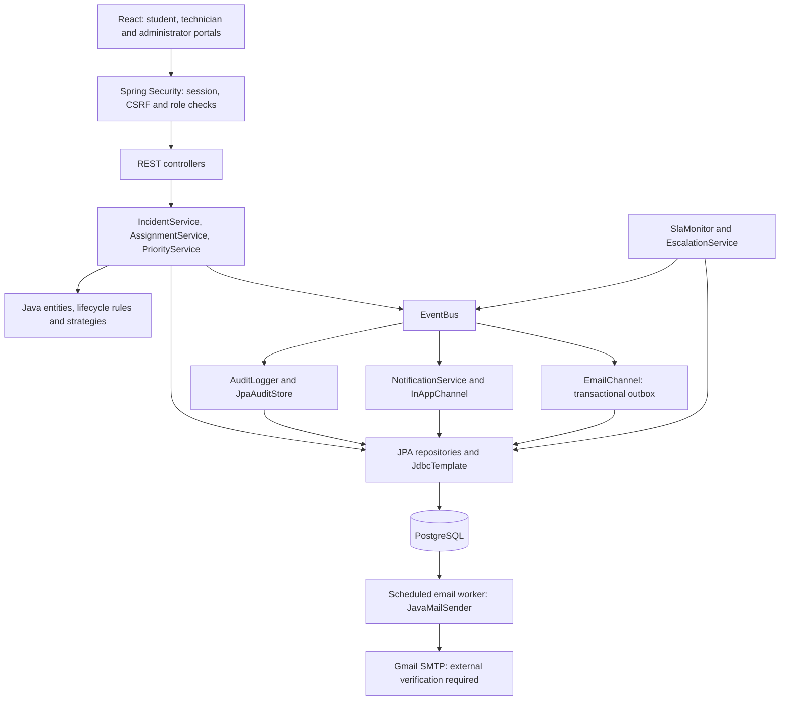
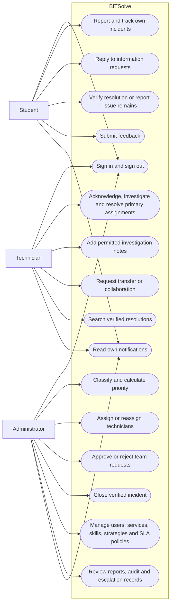
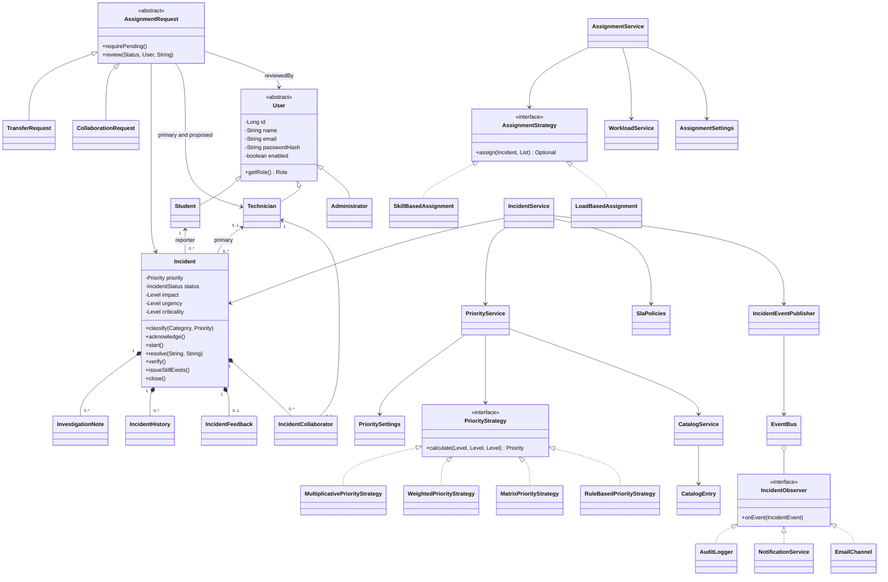
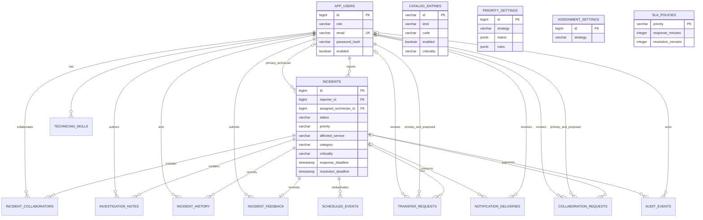

# BITSolve submission material — draft for team review

Based on the current Java, React, SQL migrations and tests. This is not a final
university report. No original assignment PDF was found in the repository;
reconcile the rubric, formatting and terminology with that PDF before submission.
Mermaid sources below are editable diagrams, not claims of external deployment.

## System architecture

React handles input/display; Java decides authorization, priority, assignment and
lifecycle validity. PostgreSQL is the persistent source of truth. JDBC is used
alongside JPA for atomic outbox claims, migrations and scheduled-event deduplication.
The Docker build packages React into the Spring Boot JAR, so production API calls
are same-origin. Local Vite proxies `/api` to Spring Boot.

Email preparation participates in the incident transaction. The scheduled worker
only sees committed rows and makes at most three delivery attempts. SMTP acceptance
is not proof of inbox delivery; crash recovery can still cause a duplicate after
an ambiguous send outcome. No live Gmail delivery is claimed.

## UML use-case draft

Mermaid flowchart notation approximates a use-case diagram; actors are outside the
system boundary and rounded nodes are use cases. Convert to formal UML notation
if the submission rubric requires it.

Collaborators can add permitted notes but do not acquire the primary technician's
acknowledge/start/resolve authority. Manual assignment still enforces eligibility.
Escalation stages are recorded labels; there are no separate Team Lead/IT Manager
login roles. Categorization is a suggestion confirmed by an administrator, not an
autonomous replacement of the incident category. No RAG system is implemented.

## UML class diagram draft

The diagram focuses on active workflows, omitting getters, DTOs and repositories
for readability. Composition means notes/history belong to an incident; it does
not imply that the application supports deleting incidents. Strategy and Observer
are useful runtime patterns, not demonstration-only wrappers. Assignment offers
the two active strategies: skill-based and load-based.

## ER diagram draft

Roles share `app_users` through JPA single-table inheritance. The two request tables
inherit Java fields from `AssignmentRequest`; that superclass has no table.
Primary/proposed request relationships represent two distinct foreign keys each.
Catalog and policy codes are resolved by Java and captured in incident snapshots;
the diagram does not invent database foreign keys for those code lookups. Settings
are singleton rows. Flyway V1–V6 are the executable schema source; empty legacy SQL
files are not a schema export. Some legacy foreign keys are installed `NOT VALID`.

## Technology selection explanation

| Technology | Reason in this implementation | Limitation to explain |
|---|---|---|
| Java 25 and Spring Boot 4.1.2 | Domain methods enforce lifecycle rules; dependency injection connects real Strategy/Observer implementations. | Runtime/build versions must match the project. |
| Spring Security and BCrypt | Server sessions, role checks, CSRF protection and one-way password hashing. | Default sessions are in-process; restarting signs users out. |
| PostgreSQL and JPA | Relational ownership/history, constraints, transactional mutations and repository queries. | Database integration tests need disposable PostgreSQL. |
| JdbcTemplate | Explicit atomic outbox claims and deduplication SQL without another queue framework. | Some locking/SQL is PostgreSQL-specific. |
| Flyway | Ordered, versioned schema upgrades with validation. | Existing data still needs a backup and migration rehearsal. |
| React and Vite | Existing reusable forms/portals; production bundle served by Spring Boot. | Rules must remain enforced in Java, not only in forms. |
| JavaMailSender / Gmail SMTP | Small reporter-only email integration using the existing event/outbox infrastructure. | Requires a privately configured App Password and real delivery verification. |
| JUnit, Mockito, MockMvc and Node test runner | Domain, authorization, persistence and API-client regression tests. | Unit/mocked SMTP results are not proof of hosted Gmail delivery. |

## Documented regression test cases

Run `npm test` and `npm run build` in frontend. Run `mvnw.cmd test` in backend.
Database tests require `BITSOLVE_DB_TESTS=true`, a separate `BITSOLVE_TEST_DB_URL`,
database credentials and `DEMO_USER_PASSWORD`. They truncate test data: never use
the actual application database. Migration tests create/drop random test databases
and need CREATEDB permission on the disposable server. Tests explicitly configure
their service fixtures; production startup does not seed service criticality.

| ID | Test source / action | Expected result |
|---|---|---|
| T01 | `UserModelTests`: construct each user subtype | Correct role and validated institutional identity. |
| T02 | `PostgresAuthenticationTests.authenticatesPersistedRolesAndLogsOut` | Database accounts authenticate; logout invalidates access. |
| T03 | `BitsolveBackendApplicationTests`: role/CSRF requests | Unauthorized roles and missing CSRF cannot mutate protected resources. |
| T04 | `IncidentWorkflowTests.completesOrderedLifecycleAndTimestamps` | Ordered lifecycle reaches CLOSED with timestamps. |
| T05 | `IncidentWorkflowTests.rejectsSkippedTransitions` | Invalid transitions throw without changing the state. |
| T06 | `IncidentWorkflowTests.rejectedResolutionReturnsToInvestigation` | Rejected resolution returns to IN_PROGRESS. |
| T07 | `PriorityStrategyTests.multiplicativeThresholds` | Impact × urgency × criticality maps to expected priorities. |
| T08 | `PriorityStrategyTests.weightedThresholds` and `invalidWeightsAreRejected` | Normalized weighted score works; invalid weights fail. |
| T09 | `PriorityStrategyTests.configurableThresholdsIncludeTheirBoundaries` | Inclusive boundaries select the intended priority. |
| T10 | `PriorityStrategyTests.matrixUsesAllNineCellsAndCapsCriticalPromotion` | All cells work; critical adjustment never exceeds P1. |
| T11 | `PriorityStrategyTests.rulesAreOrderedAndFallbackIsExplicit` | First matching rule wins; fallback is explicit. |
| T12 | `PostgresManagementTests.unconfiguredServiceIsNeverDefaultedAndRequiresAdministratorConfiguration` | Startup leaves null/disabled; creation and preview reject missing criticality; administrator values survive reinitialization. |
| T13 | `PostgresManagementTests.allFourStrategiesPreviewSwitchAndAuditWithoutChangingHistory` | Preview does not save; each model persists; historical priority/deadlines remain unchanged; audit records exist. |
| T14 | `PostgresAssignmentTests`: automatic strategy and concurrent assignment cases | Skill/capacity rules hold and cannot overallocate through concurrent requests. |
| T15 | `PostgresAssignmentTests`: transfer review cases | Approval changes primary ownership; stale/unauthorized reviews are rejected. |
| T16 | `PostgresAssignmentTests`: collaboration cases | Approved collaborator gains team access without becoming primary. |
| T17 | `SlaClockTests.capturesTargetsFromCreationAndIgnoresLaterPolicyEdits` | Deadlines are captured once from creation time. |
| T18 | `SlaMonitorTest` and `PostgresManagementTests.scheduledEventClaimSurvivesServiceReconstruction` | Warning/breach boundaries and durable deduplication work. |
| T19 | `PostgresManagementTests.notificationReadStateAndRecipientAuthorizationArePersisted` | Only the recipient can read/mark their notification. |
| T20 | `PostgresStudentEmailTests.queuesExactlyThreeReporterEventsAndDeduplicates` | One queued message per required event, addressed to the reporter. |
| T21 | `PostgresStudentEmailTests.rollbackLeavesNoQueuedMessageAndNeverCallsSmtp` and `workerCannotSeeEmailUntilTheIncidentTransactionCommits` | Rollbacks/uncommitted transactions do not send mail. |
| T22 | `PostgresStudentEmailTests.missingConfigurationKeepsPendingAndFailureRetriesAreBounded` | Missing configuration keeps PENDING; failures stop at the retry limit. |
| T23 | `PostgresMigrationTests`: upgrade V1 and V5 fixtures to latest | Users, incidents, explicit criticality, deadlines and settings survive; constraints still work. |
| T24 | `intelligence/CategorySuggesterTest`, `DuplicateDetectorTest` | Keyword ambiguity and similarity rules yield predictable suggestions. |
| T25 | `frontend/src/api.test.js`: five API-client cases | Protected 401 emits expiry; login/403/validation/network failures do not; credentials and CSRF remain intact. |
| T26 | Browser: remove session cookie, then open protected page | Dashboard disappears, existing login appears, no `/auth/me` loop; sign-in works again. |

Record dated results separately from expected outcomes. Automated Java tests use
mock SMTP; T20–T22 do not demonstrate a real email reaching a student inbox.

## Three demonstration workflows

Prepare accounts through administrator setup: one administrator, two students,
and at least two technicians with relevant skills and available capacity. Explicitly
configure/enable Campus Wi-Fi criticality. Record incident IDs for comparison.

### Workflow 1 — Complete student incident lifecycle

1. Student signs in and reports a network issue with impact/urgency. Show saved NEW incident.
2. Administrator reviews the category suggestion, classifies it and shows calculated
   priority plus captured response/resolution deadlines; assigns an eligible technician.
3. Primary technician acknowledges and starts investigation. Add an internal note,
   request student information and show that the student cannot see the internal note.
4. Student replies. Technician resolves with summary and steps.
5. Student verifies resolution and submits feedback; administrator closes the incident.
6. Reload and show the persisted history, report totals and notification read state.
7. Inspect the three student outbox entries. Show actual received mail only after a
   separately configured real SMTP test; otherwise explain PENDING/mock verification.

### Workflow 2 — Transfer and collaboration with access control

1. Create/classify a new incident and assign technician A.
2. A requests transfer to eligible B; show that ownership remains A while pending.
3. Administrator approves. B sees the incident; A loses access unless separately a
   permitted collaborator. Verify original deadlines/history remain intact.
4. B requests a collaborator with a needed skill; administrator approves A if eligible.
5. A adds a permitted note through My Team Incidents. Show that A cannot acknowledge,
   start or resolve as primary; B retains control.
6. Show workload counts for both technicians. B resolves; student verifies and admin
   closes. Confirm capacity is released and request/audit history persists.

### Workflow 3 — Runtime configuration, SLA and intelligent suggestions

1. Administrator opens IT Services: show a newly unconfigured service, explicitly
   configure it and enable it. Confirm invalid missing-criticality use is rejected.
2. Preview the same impact/urgency/service with all four priority strategies. Save
   one, reload the settings and classify a new incident using the saved configuration.
3. Show an older incident retains its priority and deadlines after settings edits.
4. On a disposable demo database, set a short response target for the new incident's
   priority before classification; leave it unacknowledged until warning/breach.
5. Show the persisted SLA event/notification and audit. For P1, show escalation stages;
   explain these are stage labels routed to current technicians/admins.
6. Submit a similar open incident for the same service. Show duplicate suggestion
   and keyword category suggestion, with administrator judgment retained.
7. Finish the lifecycle and review reports; demonstrate expired-session recovery.

## Review and submission checklist

- Compare these drafts against the original university PDF and grading rubric.
- Render and review all diagrams; verify multiplicities and terminology with the team.
- Expand into the required report format, team contributions and references.
- Export an accurate schema if a standalone SQL deliverable is required; keep Flyway authoritative.
- Review/commit the intended implementation and provide the final repository link.
- Record the three workflows and final presentation; neither is completed by this draft.
- Verify Gmail, hosted PostgreSQL, Docker and HTTPS in the target environment before
  claiming successful deployment. No Railway deployment is performed by these drafts.
